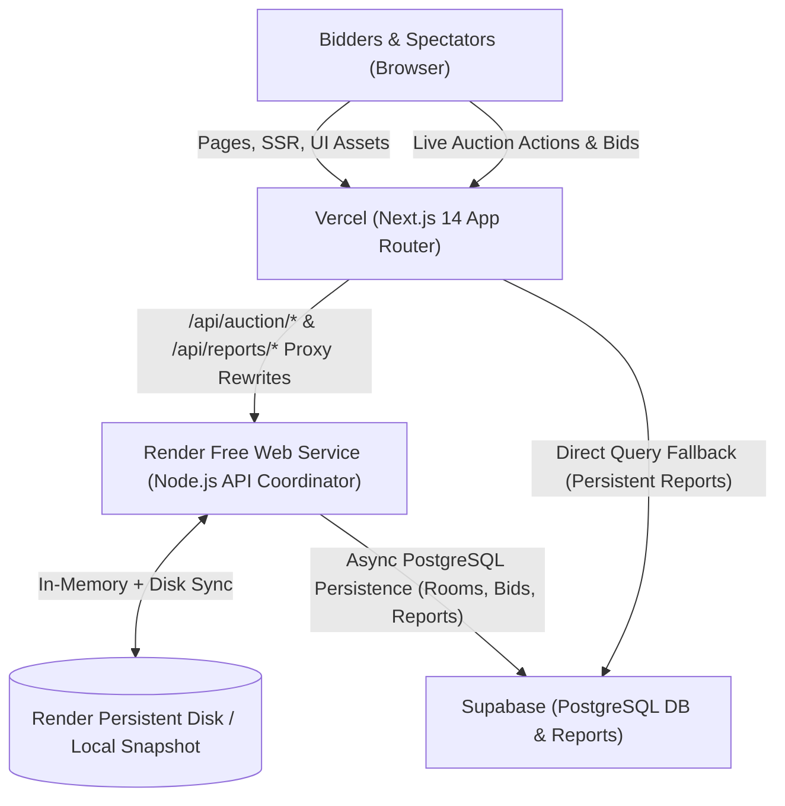

# IPL Auction Arena — Multi-Cloud Deployment Guide
### Vercel (Frontend & UI) + Render (Persistent Backend Coordinator) + Supabase (PostgreSQL Database)

---

## 🏛️ System Architecture



| Component | Provider | Role & Responsibility |
|---|---|---|
| **Frontend & UI** | **Vercel** | Fast global edge CDN hosting Next.js App Router, SSR, UI assets, client landing page, and transparent API proxying. |
| **Backend Coordinator** | **Render (Free Tier)** | Single persistent Node.js service running live room state, authoritative bid countdown loops, 15-second timer extensions, and disk snapshots. |
| **Relational Database** | **Supabase** | Managed PostgreSQL database storing immutable bid logs, team squads, participant sessions, and permanent retrospective reports. |

---

## 🚀 Step 1: Configure Supabase Database

1. Go to [supabase.com](https://supabase.com) and create a free project.
2. In the Supabase Dashboard, open the **SQL Editor**.
3. Copy and run the schema migration:
   - File: `supabase/migrations/20261021_initial_schema.sql`
4. Copy and run the initial franchise & player seeds:
   - File: `supabase/seed.sql`
5. Go to **Project Settings > API** and copy:
   - **Project URL**
   - **anon / public key**
   - **service_role secret key**

---

## 🚀 Step 2: Deploy Backend to Render (Free Web Service)

### Option A: Using Render Blueprints (`render.yaml` — Recommended)
1. Push your repository to GitHub.
2. In [dashboard.render.com](https://dashboard.render.com), click **New + > Blueprint**.
3. Connect your repository. Render will automatically detect `render.yaml`.
4. Fill in the environment variables:
   - `SUPABASE_URL`: Your Supabase Project URL
   - `SUPABASE_SERVICE_ROLE_KEY`: Your Supabase Service Role Secret
5. Click **Apply**. Render will build and deploy `ipl-auction-arena-api`.
6. Note your Render URL (e.g. `https://ipl-auction-arena-api.onrender.com`).

### Option B: Manual Web Service Setup
1. Click **New + > Web Service** on Render.
2. Build Command: `npm install && npm run build:server`
3. Start Command: `npm run server:start`
4. Plan: **Free**
5. Add Environment Variables:
   - `PORT`: `10000`
   - `DATA_DIR`: `./data`
   - `CORS_ORIGIN`: `*`
   - `SUPABASE_URL`: `<your-supabase-url>`
   - `SUPABASE_SERVICE_ROLE_KEY`: `<your-supabase-service-role-key>`
6. Verify Health: Visit `https://<your-render-url>/health` to see JSON health metrics.

---

## 🚀 Step 3: Deploy Frontend to Vercel

1. In [vercel.com](https://vercel.com), import your GitHub repository.
2. Framework Preset: **Next.js**.
3. Under **Environment Variables**, add:
   - `RENDER_BACKEND_URL`: `https://<your-render-service-name>.onrender.com`
   - `NEXT_PUBLIC_APP_URL`: `https://<your-vercel-domain>.vercel.app`
   - `NEXT_PUBLIC_SUPABASE_URL`: `<your-supabase-url>`
   - `NEXT_PUBLIC_SUPABASE_ANON_KEY`: `<your-supabase-anon-key>`
   - `SUPABASE_SERVICE_ROLE_KEY`: `<your-supabase-service-role-key>`
4. Click **Deploy**.

> [!TIP]
> **Zero CORS Configuration Needed:**
> Next.js automatically rewrites `/api/auction/*` and `/api/reports/*` from the Vercel domain to your Render backend via `next.config.mjs`. Browsers communicate directly with your Vercel URL without cross-origin preflight overhead.

---

## ⚡ Step 4: Render CLI Operations & Management

The official **Render CLI (v2.30.0)** is pre-installed at `~/.local/bin/render`.

### 1. Authenticate with your Render Account
Run either command in your terminal:
```bash
# Option A: Interactive Browser Login
render login

# Option B: Headless / API Key
export RENDER_API_KEY="rnd_your_key_here"
```

### 2. Useful Render CLI Commands
```bash
# Check current authenticated workspace
render whoami

# List all services and their live status
render services

# View live streaming logs of the backend coordinator
render logs

# SSH directly into the running backend container (inspect disk snapshot at ./data)
render ssh <service-id>

# Trigger deployment from render.yaml blueprint
render blueprints launch

# Restart backend service
render restart <service-id>
```

---

## 🧪 Local Testing & Verification

You can test the entire multi-service setup locally:

```bash
# Terminal 1: Start Render-style Backend Coordinator
npm run server:start

# Terminal 2: Start Vercel-style Next.js Frontend
RENDER_BACKEND_URL=http://localhost:10000 npm run dev
```

Visit [http://localhost:3000](http://localhost:3000) to create a room, place bids, test countdown auto-extensions, and generate analytical reports.
